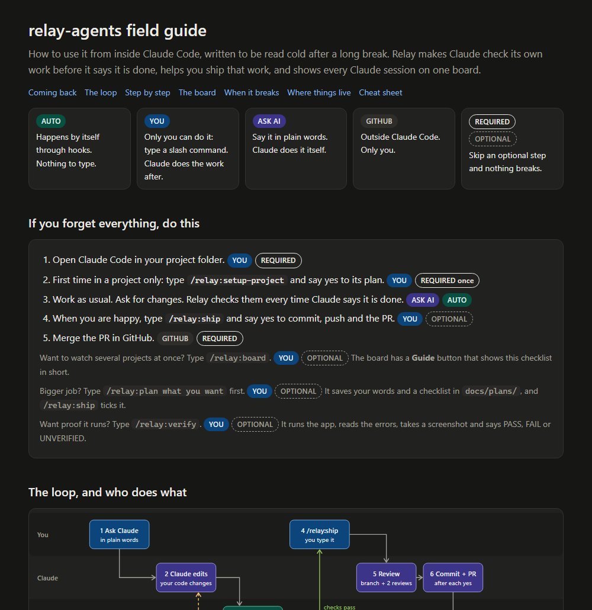
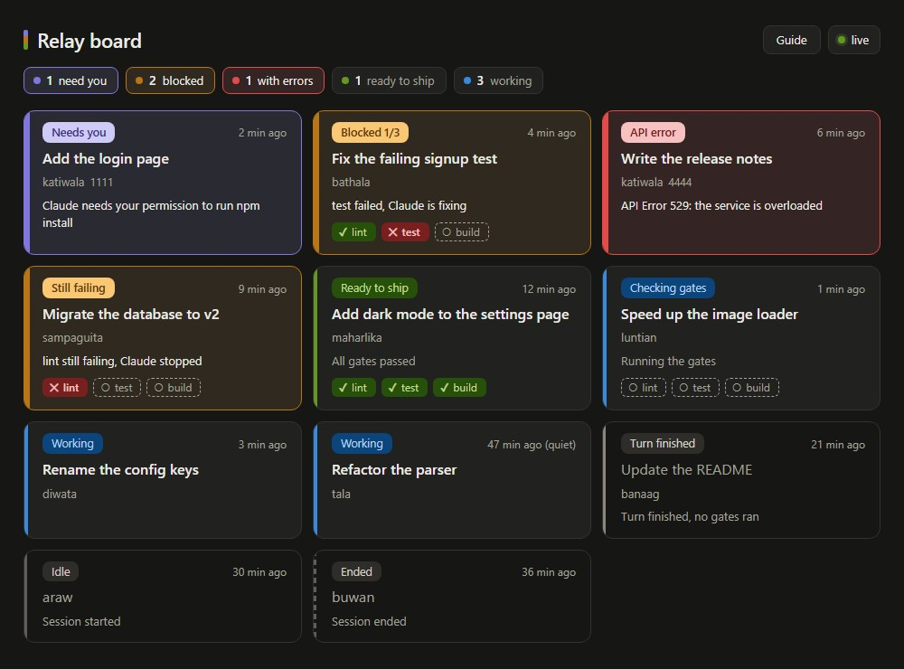
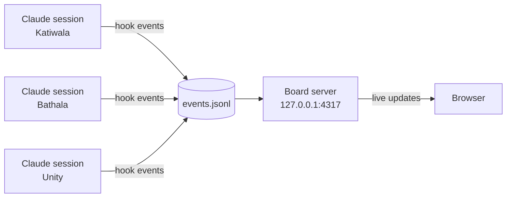

# relay-agents

A playground for learning AI engineering with Claude Code. It holds two things that run side by side, enabled for this repo only:

- **relay**: my own Claude Code plugin (three agents, five skills, a Stop-hook quality gate, and a live status board for every Claude session).
- **SuperClaude** v4.3.0: a third-party command and agent framework, installed at project scope: 30 `/sc:*` commands in `.claude/commands/sc/` and 20 agents in `.claude/agents/`. It has no Claude Code plugin yet, and its official installer writes to global `~/.claude`, so it is installed by script instead. See `THIRD_PARTY/SuperClaude-LICENSE.md` for its license, the script and how to refresh it.

## Quick guide: read this first after a break

[](docs/guide.html)

Open [`docs/guide.html`](docs/guide.html) from your local clone (double-click it, or ask Claude to open it). GitHub shows an HTML file as source code, so it only looks right locally. It is written for someone who works inside Claude Code: every step says who does it (you type a command, you ask Claude, it happens by itself, or it is on GitHub) and whether it is required or optional. It also has the board's card meanings, fixes for common problems, where everything lives, and a command cheat sheet.

The same checklist, shorter, is built into the board: click **Guide** at the top of the board page. It opens by itself when the board has no cards.

## How the pieces fit

```
docs/guide.html                   the visual field guide (open in a browser)
docs/plans/                       plans written by /relay:plan (this repo's roadmap is the first)
AGENTS.md                         the brief for any coding agent here: commands, rules, known traps
CLAUDE.md                         one line that imports AGENTS.md
.github/workflows/ci.yml          CI: the self-test on Ubuntu and Windows for every PR
.claude-plugin/marketplace.json   the catalog: "relay-agents" lists the plugin "relay"
plugins/relay/                    the plugin itself
  .claude-plugin/plugin.json      name, version, license
  agents/reviewer.md              read-only reviewer
  agents/security-reviewer.md     read-only security reviewer
  agents/tester.md                writes tests in the project's own style
  skills/setup-project/SKILL.md   /relay:setup-project
  skills/plan/SKILL.md            /relay:plan
  skills/verify/SKILL.md          /relay:verify
  skills/ship/SKILL.md            /relay:ship
  skills/board/SKILL.md           /relay:board
  hooks/hooks.json                registers the hooks
  hooks/gates.mjs                 the quality gate (Node, no dependencies)
  hooks/emit.mjs, events.mjs      silent hook that records status events
  board/server.mjs, state.mjs     the board's server and its event-to-card logic
  board/index.html                the board page and its short guide
  (tests sit next to the code; events.mjs is covered by emit.test.mjs)
.claude/                          this repo's own config (relay.json, settings.json, verify.md)
.claude/commands/sc/, agents/     SuperClaude (third-party, see THIRD_PARTY/)
```

- **Marketplace**: a catalog file that tells Claude Code where plugins live, so other repos can install relay by name.
- **Plugin**: a folder of agents, skills and hooks that Claude Code loads as one unit. Its commands are prefixed with the plugin name, for example `/relay:ship`.
- **Agent** (subagent): a specialist Claude can hand a job to, with its own tool allowlist. `reviewer` and `security-reviewer` only have Read, Grep and Glob, so they cannot edit anything. `tester` can edit and run, but its instructions limit it to test files.
- **Skill**: a reusable instruction file that runs when you type its command. All five relay skills set `disable-model-invocation`, so they are never loaded unless you call them.
- **Hook**: a script Claude Code runs at a lifecycle event. relay uses `Stop`, which fires each time Claude says it is done, plus five more events for the board.

## The quality gate (Stop hook)

`hooks/gates.mjs` reads `.claude/relay.json` in the project and decides whether Claude may stop:

1. No `.claude/relay.json`: allow the stop.
2. Not a git repo, or `git status` shows no changes: allow the stop.
3. Otherwise run each gate command in order. At the first failure, print the gate name and the last 40 lines of its output to stderr and exit 2. Exit 2 tells Claude Code to keep going, so Claude sees the failure and fixes it.
4. After 3 blocked stops in a row, the 4th stop is allowed with a notice that the gate is still failing. A passing run resets the count. The counter lives in the OS temp folder, never in your repo.

`.claude/relay.json`:

```json
{
  "gates": [{ "name": "test", "cmd": "npm test" }],
  "slow": [{ "name": "build", "cmd": "npm run build" }],
  "timeoutSec": 120
}
```

`gates` run at every stop and must be fast. `slow` is for the build and checks too slow for every stop; only `/relay:ship` runs them. A check that needs a running server fits neither list.

Self-test: `node --test "plugins/relay/**/*.test.mjs"`.

CI: `.github/workflows/ci.yml` runs the same self-test on Ubuntu and Windows for every pull request and every push to `main`. It skips `claude plugin validate`, because the runner has no Claude CLI; the Stop gate here still runs that one locally. CI is advisory: without branch protection, a red run does not block a merge.

## The board: every session at a glance



*Demo data. The two Katiwala cards are two sessions in one repo, told apart by a short tag.*

When several Claude sessions run in different repos, the board answers "which one needs me?" without switching windows. It is a small local web page, one card per session, that updates live.



Start it from any session where relay is enabled with `/relay:board`, or run `node plugins/relay/board/server.mjs [--port 4317] [--data <folder>]`. The **Guide** button on the page shows a short step-by-step of how to use relay, with a badge on each step for who does it and whether it is optional.

| Card | Meaning | Comes from |
|---|---|---|
| Working | You sent a prompt | `UserPromptSubmit` |
| Checking gates | The Stop gate is running | `GatesStart` (from `gates.mjs`) |
| Blocked n/3 | A gate failed and Claude is fixing it | `Stop`, result `blocked` |
| Still failing | 3 blocked stops in a row, so relay let Claude stop | `Stop`, result `released` |
| Ready to ship | All gates passed | `Stop`, result `passed` |
| Needs you | A permission prompt or Claude is waiting for you | `Notification` |
| Turn finished | The turn ended and no gates ran (no `relay.json`, or nothing changed) | `Stop`, result `skipped` |
| API error | The turn ended on an API error such as a rate limit | `StopFailure` |
| Idle, Ended | A session started or ended | `SessionStart`, `SessionEnd` |

**How it is built.** `emit.mjs` appends one JSON line per event to `events.jsonl` in the plugin's data folder (`CLAUDE_PLUGIN_DATA`, a file past 1 MB is moved aside). `state.mjs` is a pure function from events to one card per session, so it is easy to test. `server.mjs` polls the file once a second (more reliable than `fs.watch` on Windows) and pushes changes to the page over Server-Sent Events. The page uses no libraries and builds its DOM with `textContent`, because card text comes from your prompts.

**Privacy and safety.**
- The server listens on `127.0.0.1` only, is read-only, answers any other `Host` header with 403, and sends a strict Content-Security-Policy.
- `events.jsonl` stores the first 60 characters of each prompt as the card's task line. It stays on your machine.
- The emit hook prints nothing. Output from `SessionStart` and `UserPromptSubmit` hooks is added to Claude's context, so a chatty hook would cost tokens on every turn.

**Which cards show.**
- A card appears only after a real session start, prompt, notification, failure or end event. A gate run by hand sends only gate events, so it never gets a card.
- A card disappears after 12 hours without events, or 24 hours for "needs you", "blocked" and "API error", because a window that was closed may never send `SessionEnd`. Ended sessions go after an hour. A working, checking or waiting card with no event for 30 minutes shows "(quiet)".
- A context compaction restarts the session but leaves its card as it was.
- Background-task notifications and subagent hand-backs are automated turns. They keep the task text you typed.

**Limits.**
- A session that was already running when relay loaded gets its card at its next prompt or session start.
- "Needs you" stays until the next event: no hook fires when you answer a permission prompt, so the card clears at the next prompt or stop.
- "Ready to ship" means the gates passed. It does not know whether you have committed or opened a PR.
- When `events.jsonl` passes 1 MB it is moved aside to `events.1.jsonl` and the board reads only the new file, so a session that sends no event after that drops off until its next one. That takes thousands of events.
- Hooks start a Node process per event. The delay is small but I have not measured it.

## Skills

- `/relay:board`: starts the board server and opens the page.
- `/relay:setup-project`: run once in a new repo. Detects the stack, tries each check and keeps only those that pass today and need no running server, writes `.claude/relay.json` (an existing one is kept), writes an `AGENTS.md` brief and a one-line `CLAUDE.md` that imports it (each only if missing, never overwritten; if both exist without an import, it offers to add one), and adds deny rules for deploy, publish and remote-database scripts. It shows everything before writing.
- `/relay:plan [what you want]`: for a bigger job. Saves your words word for word, a goal, up to 6 phases with tick boxes, assumptions and a log in `docs/plans/<slug>-<date>.md`, after you confirm. It writes no code and does not start the work.
- `/relay:verify [what to check]`: runs the real app from the recipe in `.claude/verify.md` (or drafts one and asks first), drives it with the built-in browser, counts console errors, failed requests and app log errors, takes a screenshot, and ends PASS, FAIL or UNVERIFIED with the evidence. It opens only localhost, never uses real credentials, never kills a process it did not start, and stops what it started.
- `/relay:ship [task]`: runs the gate and the slow checks, sends the change (untracked files included) to the `reviewer` and `security-reviewer` agents, follows the verify recipe when the change touches the app and a recipe exists (a FAIL stops it and asks you), ticks the boxes of a plan in progress whose "Done when" check it has just confirmed (and logs it), then asks before commit, push and PR, with a Checks list in the PR body. It refuses to work on `main`.

## Install relay in another repo

From the other repo's folder:

```bash
claude plugin marketplace add Phreyle/relay-agents --scope project
claude plugin install relay@relay-agents --scope project
```

Then start Claude Code and run `/relay:setup-project`. Commit that repo's `.claude/settings.json` so collaborators get the same setup (each collaborator runs the install command once). Commit `.claude/relay.json`, `AGENTS.md` and `CLAUDE.md` too. This repo is private, so it works wherever your git login works.

## Update relay

`plugin.json` pins `version`, so users only get a new copy when that string changes. After pushing a change:

1. Bump `version` in `plugins/relay/.claude-plugin/plugin.json`.
2. In each repo that uses relay: `claude plugin marketplace update relay-agents`, then `claude plugin update relay@relay-agents --scope local`. Use the scope you installed with; `claude plugin list` shows it.
3. In each running session, `/reload-plugins`.
4. If the board is running, stop it and start it again with `/relay:board`. A running board keeps the code it started with.

**Testing unmerged changes.** Once relay is installed (any scope), Claude Code uses the installed copy. That copy comes from the marketplace source (GitHub `main` for this repo), not from your working folder, and a second install of the same version reuses the cached copy. So a change on a branch cannot reach a session through `claude plugin install` or `update` until it is merged to `main` and the version is bumped. To try a change first, start a session with `claude --plugin-dir ./plugins/relay`. Per the Claude Code docs, a plugin loaded that way replaces the installed copy of the same name for that one session. Before anything is installed, this repo loads relay straight from `plugins/relay/` through `.claude/settings.json`, and edits apply at the next session start or `/reload-plugins`.

## What it costs in context

Everything Claude loads every turn costs tokens. Measured with `/context` on 2026-10-14:

- **relay: about 130 tokens per turn** (79 measured on 2026-10-14 with two agents, plus about 50 estimated for `security-reviewer` from its description's length, 107 characters against the reviewer's 87; not re-measured with `/context`). The `reviewer` and `tester` agent descriptions cost 44 and 35. None of the skills appears in the Skills list (all five set `disable-model-invocation`), so they cost nothing until you run them. The hooks add no tokens: the gate costs nothing unless it blocks, and the board's emit hook is silent. (Measured before the board existed; its hooks add no description, so I expect no change but have not re-measured.) `claude plugin details relay` prints a static estimate that counts the skills and so overstates (about 123 tokens when I last ran it, with three skills and before `/relay:plan`).
- **SuperClaude: about 0.9k tokens per turn.** Custom agents went from 1.1k to 2.0k for its 20 agents (about 45 each). The Skills line stayed at 9.8k, so its 30 commands showed no measurable cost there. These figures compare two sessions and are rounded to 0.1k.
- **This repo's `AGENTS.md`: about 1,150 tokens per session** (4,605 characters on 2026-10-16 at roughly 4 characters per token; an estimate, not measured with `/context`, and the file will grow). A brief is loaded into every session of the project, so keep it short.
- **Lean mode (Pro plan):** `.claude/settings.json` sets `CLAUDE_AUTOCOMPACT_PCT_OVERRIDE` to 15, so a new session and its subagents auto-compact at 15% of their own context window (about 150k tokens of a 1M window) instead of 97%, and the `AGENTS.md` Token budget block asks for one session per task, narrow `relay:*` agents and one review pass per PR. It assumes the 1M window: on a 200k window 15% is 30k, below the roughly 80k tokens a session starts with (76k by `get_usage` on 2026-10-16), so remove the override there.

## License

MIT. See `LICENSE`.
